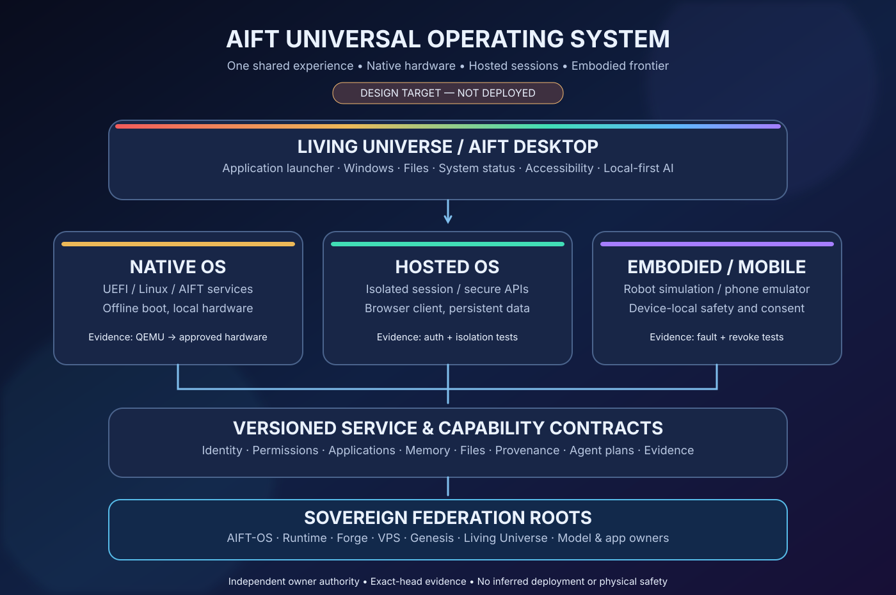

# AIFT Universal Operating System — Architecture and Source of Truth

> **Design proposal • November 2026.** This document is a multi-repository development target, not evidence of a shipped operating system, installable phone image, working UEFI boot manager, certified robot or live hosted service. Actual implementation and maturity belong to the code, tests and release records in each owning repository.

## Objective

Build **one sovereign, local-first AIFT operating environment across native hardware, hosted sessions and embodied/mobile devices** while preserving distinct real-world capabilities and security boundaries. The Living Universe is its public experience and proposed immersive desktop, not its host kernel. The existing AIFT-OS Go federation kernel is an **application-level orchestration and command layer**, not a replacement for Linux or firmware.

**Three distinct boots:** (1) firmware/UEFI/boot manager; (2) Linux kernel, initramfs and userspace; (3) AIFT federation service startup. Never report a success in one as proof of another.

**One intelligence, many bodies; no implicit transfer of authority.** Personal memory, preferences, tasks and approved skills may be portable. Camera, microphone, files, network, phone modem, actuators, firmware and physical safety privileges remain revocable, scoped to a device/session/action and independently checked.

## Platform modes

| Mode | Proposed stack | Required proof |
|---|---|---|
| **Native OS** | x86-64 UEFI/OVMF → established Linux kernel → init/service supervisor → AIFT-Runtime and OS → native desktop | Cold QEMU boot serial log, hashes, reboot, offline service health, real user journey |
| **Hosted OS** | Isolated authenticated hosted session → scoped application/file/AI services → browser-based AIFT desktop | Real session isolation, persistent state, denial tests, backup/restore, deployment evidence |
| **Mobile OS** | Hardware-appropriate ARM64/AOSP-derived components → permissions, HALs, kernel/driver, telephony/power → AIFT apps/agents | Android emulator first; then model-specific hardware tests, not presumed arbitrary phone installability |
| **Embodied OS** | Linux/ROS 2 orchestration with supported real-time/MCU controllers and independent safety | Sensor → plan → safety gate → **simulated** actuation; negative/fault tests; separate approved physical safety trials |
| **Pre-boot chooser** | Real UEFI app/boot manager or separately supported Apple/board-specific boot path | Reversible two-target selector and recovery in virtual hardware before physical tests |

## Federation repository roles

| Repository | Owns in this architecture; does **not** imply operational implementation |
|---|---|
| [AIFT-OS](https://github.com/AIFreedomTrustFederation/AIFT-OS) | Platform architecture, federation control plane, evidence ledger, boot/native prototype coordination |
| [AIFT-Runtime](https://github.com/AIFreedomTrustFederation/AIFT-Runtime) | Local service adapters, health, authorized execution and offline status |
| [AIFT-Forge](https://github.com/AIFreedomTrustFederation/AIFT-Forge) | App SDK, packaging, agent/skill interface, reproducible builds |
| [VPS](https://github.com/AIFreedomTrustFederation/VPS) | Hosted sessions, provider nodes, storage, routing, deployment/recovery |
| [www.aifreedomtrust.com](https://github.com/AIFreedomTrustFederation/www.aifreedomtrust.com) | Canonical public Living Universe visual benchmark and future desktop design language |
| [AIFT-Genesis](https://github.com/AIFreedomTrustFederation/AIFT-Genesis) | Canonical versioned Tree/schema lineage; preserve governance and identity authority |
| [AI-Freedom-Trust](https://github.com/AIFreedomTrustFederation/AI-Freedom-Trust) | Public doctrine/research; philosophy is not implementation evidence |
| [AetherianGovernance](https://github.com/AIFreedomTrustFederation/AetherianGovernance) | Consent, policy and governance research, not a unilateral grant of machine authority |
| [TheMindofAll](https://github.com/AIFreedomTrustFederation/TheMindofAll) | Model artifacts, model cards, memory and consciousness research |
| [mobox](https://github.com/AIFreedomTrustFederation/mobox) | Upstream-derived Android/Termux application compatibility, not a bootloader |
| Other publishing, commerce, economy, ecology and media projects | Independent, opt-in application consumers with their own author, customer, custody, safety and release boundaries |

The biological UXI model remains immutable: **roots = source repositories/provenance; trunk = verified integration; branches = actual systems; leaves = documented capabilities; flowers = verifiable emerging work; fruits = functioning visitor-facing outcomes.** No invented fruits or simulated status presented as live.

## System blueprint

~~~mermaid
flowchart TB
  FW["UEFI or supported device boot chain"] --> LINUX["Linux kernel / init / host services"]
  LINUX --> NATIVE["AIFT native host adapter"]
  CLOUD["Authenticated isolated hosted session"] --> API["AIFT versioned service APIs"]
  NATIVE --> API
  API --> UI["Living Universe desktop + applications"]
  API --> AI["Approved local-first Aetherion / agent provider"]
  API --> REG["Federation evidence, graph and catalog"]
  MODEL["Model-generated proposal"] -.-> SAFE["Independent capability / safety policy gate"]
  SAFE --> SIM["Robot simulator / approved device controller"]
  USER["Human consent + audit + revocation"] --> API
  USER --> SAFE
~~~

*This is a target relationship diagram, not proof of deployed endpoints or physical robot support.*

## Contract inventory: design only until verified

- **Device capability:** target/arch/hardware model, driver profile, supported operations, limitations, user grant, revoke/expiry, measured and mocked status.
- **Boot artifact evidence:** exact source SHA, build inputs, UEFI/firmware image, kernel/initramfs digests, architecture, VM profile, boot/reboot logs, recovery evidence.
- **Service health:** host boot ID, actual process/service state, timestamp, measured readiness, degraded/offline status, accepted API version.
- **Application package:** app identity and owner, manifest schema, artifact hashes, native/hosted compatibility, sandbox permissions, storage scope and rollback.
- **Session/security:** authenticated identity, least-privilege scoped access, separation between browser and native host, user-visible audit and explicit sensitive consent.
- **AI execution:** agent/model provenance, input sources, bounded plan, proposed operation, policy result, tool evidence and human escalation.
- **Physical device:** actuator/sensor classes, simulated-vs-real flag, independent watchdog/e-stop, constraints and fail-closed command arbitration.

## Milestone and evidence roadmap

| Milestone | Must demonstrate | This document's status |
|---|---|---|
| **OS-00** | Architecture, threat model, owner contracts and verified baseline | Proposed |
| **BOOT-01** | Reproducible x86-64 QEMU/OVMF bootable Linux image and serial evidence | Not verified |
| **BOOT-02** | Pre-boot AIFT graphic selector, virtual second EFI target and recovery | Not verified |
| **OS-01** | Supervised local AIFT services, logs, offline status and bounded restart | Not verified |
| **DESKTOP-01** | Real native app launcher, windows, files/settings, accessibility | Not verified |
| **HOST-01** | Authenticated isolated browser workspace with real service APIs | Not verified |
| **INSTALL-01** | Virtual disk install/update/rollback and rescue image | Not verified |
| **WIN-01** | Safe Windows Boot Manager coexistence and boot selection on virtual GPT/ESP | Not verified |
| **MAC-I-01 / MAC-AS-01** | Model-specific Intel Mac EFI / Apple Silicon m1n1 paths | Not verified |
| **PHONE-01** | Permissions, local AI, offline/power and app lifecycle in emulator | Not verified |
| **ROBOT-01** | ROS 2 simulated robot with independent safety gate and fault injection | Not verified |
| **RELEASE-01** | Reproducibility, artifact digests, security review and recoverability | Not verified |
| **HW-ALPHA** | Approved target hardware, reversible install and operator sign-off | Not verified |

**Evidence rule:** a code repository, named automation, CI green check, documentation paragraph, prototype mock, offline model response or static website cannot substitute for boot/hosted/physical evidence. Record the environment, test command, source SHA, produced artifact, logs and failure conditions. Maintain differences among PASS, FAIL, UNRUN, BLOCKED and APPROVAL REQUIRED.

## Development engines: responsibilities, not deployment claims

- **Federation Continuous Engineering:** bootable Linux/UEFI/QEMU, local runtime, shared APIs, integration and dependency ledger.
- **Living Universe UXI:** public HTML visual benchmark, operating-system desktop, app journeys and pre-boot *design*; browser preview is not firmware execution.
- **Cloudflare / Universal Release Readiness:** hosted/native boot-image release verification, signatures, recovery and go/no-go evidence without unilateral deployment.
- **VPS opt-in merger:** only explicitly labeled, eligible routine VPS PRs; firmware, boot, install, signing and security changes excluded.
- **Embodied Frontier OS:** virtual mobile and robotic simulation, portable cognition, independent physical safety and permissions; no physical actuation without separate approval.

All engines must read applicable AGENTS.md, preserve per-repository ownership, inspect exact-head CI and prior milestone evidence, reuse existing PRs, avoid overlapping edits, and publish traceable next-step evidence. **No hidden coordination, automatic merging of sensitive changes, or unapproved hardware operations.**

## Documents and reference infographics

- [Boot, Apple, Windows and hardware compatibility](boot-and-device-compatibility.md)
- [Embodied Frontier OS: robots, phones, wearables](embodied-frontier-os.md)
- [OS desktop and service interfaces](desktop-and-service-contracts.md)
- [Acceptance, verification and safe handoffs](verification-and-release.md)
- [AIFT platform layers infographic](diagrams/aift-platform-layers.svg)
- [Boot and device compatibility infographic](diagrams/aift-boot-modes.svg)

## External engineering references

[UEFI Forum](https://uefi.org/specifications) · [Asahi boot process](https://asahilinux.org/docs/alt/boot-process-guide/) · [Asahi m1n1](https://asahilinux.org/docs/sw/m1n1-user-guide/) · [Android Open Source Project](https://source.android.com/) · [ROS 2 Control](https://control.ros.org/) · [Zephyr](https://docs.zephyrproject.org/). These sources explain candidate platform mechanisms, not proof AIFT implements them.
