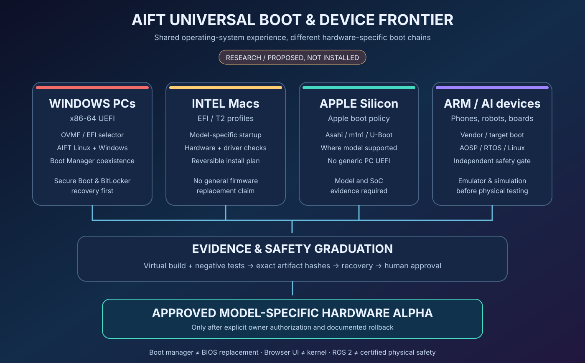

# AIFT Universal Boot: PC, Windows, macOS, Apple Silicon and ARM Devices

> **Proposal and compatibility research, not an AIFT installer.** No AIFT bootable ISO/USB, UEFI selector, firmware replacement or physical device installation is verified by this document. Never use this roadmap as authorization to modify an actual disk, Secure Boot policy, Apple startup policy, BitLocker state or firmware.

## Four separate engineering products

1. **Pre-boot interface / boot manager:** an AIFT-branded, keyboard-accessible UEFI application or supported target-specific boot menu. It discovers compatible targets and hands control to another loader. It is not itself the motherboard firmware.
2. **AIFT native operating system:** a reproducible Linux kernel + initramfs + userspace, host services, supported drivers and desktop, launched by a supported loader.
3. **Installer and recovery environment:** an image that can inspect compatible hardware, produce backups/recovery information, and install only after explicit consent and a safe rollback plan.
4. **Experimental firmware program:** board-specific coreboot/EDK II/U-Boot research, *separately authorized*. No general BIOS replacement claim. Firmware flashing can brick hardware and is outside unattended task authority.

## Per-platform boot matrix

| Target | Candidate initial boot route | Compatibility limits and risks | Validation stage |
|---|---|---|---|
| **x86-64 Windows-class PC** | OVMF/UEFI → signed/appropriate loader → AIFT Linux; optional chainload existing Windows Boot Manager | GPT/ESP layout, Secure Boot, TPM, BitLocker recovery, existing EFI entries and vendor firmware vary | **QEMU/OVMF virtual disk first**, no real NVRAM |
| **Older legacy BIOS PC** | Optional later GRUB BIOS/MBR-style experimental support | Legacy BIOS is not interchangeable with UEFI; MBR partition limitations; avoid obsolete-device promises | Separate isolated virtual profile |
| **Intel Mac without T2** | Firmware-supported EFI boot manager/selector | Mac model/firmware, graphics, network and storage compatibility differ | Hardware-specific investigation after virtual validation |
| **Intel Mac with T2** | EFI path subject to Startup Security Utility and supported Linux drivers | T2 controls startup, storage/input and security; no bypass or arbitrary generic image claim | Separate exact-model approval |
| **Apple Silicon** | Apple's boot policy → supported Linux environment via Asahi/m1n1 and often U-Boot | Apple Boot ROM is not generic PC BIOS; per-SoC/model drivers and policy, owner authorization, recoverability | Research and official supported-model matrix; no generic UEFI install |
| **ARM64 development boards** | Board-specific U-Boot/EFI/boot ROM + target kernel and device tree | SoC, BSP, serial console, storage, power and GPU differ | QEMU when representative, then approved test board |
| **Future phones** | Vendor-defined locked/verified boot + AOSP/GKI/HAL or supported replacement project | Carrier modem/IMS/emergency calls, bootloader policy, camera/GPU, secure storage, power and OTA | Emulator first; **no personal phone flashing** |

**No single AIFT binary will be asserted to boot every platform.** Shared UI theme and application/service contracts can be consistent while the actual boot and hardware layers differ.

## BOOT-01 virtual acceptance contract

1. Define a pinned x86-64 UEFI target, reproducible build toolchain and versioned machine-readable artifact manifest.
2. Generate a minimal Linux-based AIFT development image using established, appropriately licensed components and explicit build inputs.
3. Boot from a new disposable QEMU disk with OVMF; capture actual boot menu, serial kernel/init messages, machine architecture and exit state.
4. Demonstrate working native AIFT host service with truthful offline health, then cold reboot and verify persistence when expected.
5. Record source SHA, dependency versions, build command, artifact SHA-256, QEMU flags, OVMF version, logs, screenshot if available and failure/rollback steps.
6. Ensure the whole test uses a virtual disk and never touches host EFI variables, user disks, NVRAM or keys.

## BOOT-02 dual-boot and recovery tests

Use **two disposable virtual targets**, initially AIFT Linux and a trivial non-destructive EFI test application; later a properly licensed Windows virtual installation if available and approved.

Test: discovery without writing; intentional selection; clean return on target failure; fallback to AIFT/recovery; correct error for absent or malformed ESP entry; refusal of unapproved key changes; repeatable boot order after restart; preservation of existing virtual target data. Prove boundaries rather than bypassing Secure Boot/BitLocker.

**Windows-specific acceptance:** enumerate virtual Windows Boot Manager without replacing it, study TPM/BitLocker recovery impact, independently confirm the original Windows path still boots, document a no-change rollback. Do not offer one-click dual boot on real Windows machines before this is proven and explicitly approved.

**macOS-specific acceptance:** Intel Mac and Apple Silicon require distinct device matrices. For Apple Silicon, [Asahi's documented boot process](https://asahilinux.org/docs/alt/boot-process-guide/) and [m1n1](https://asahilinux.org/docs/sw/m1n1-user-guide/) are the starting references, not a promise of firmware replacement. OS selection may require Apple's own startup controls, and support cannot be generalized from one model to another.

## Physical-device release gates

**Gate A — verified model:** vendor, model, CPU/SoC, firmware generation, GPU, storage, network, security features, tested peripherals and documented limitations.

**Gate B — nondestructive preparation:** backups, recovery media, boot entries exported, full-disk encryption recovery key handled privately by owner, BIOS/UEFI settings and external boot security recorded.

**Gate C — owner approval:** the human owner understands potential data loss, available revert procedures and exact proposed physical modifications. A model-generated plan or scheduling automation is not approval.

**Gate D — controlled proof:** serial/console evidence when available, boot, reboot, safe power loss, updates, rescue, data-preservation verification, accessibility and failed-boot recovery.

**Gate E — release:** artifact hashes, code provenance, license review, signed components where required, independent security review and tested rollback on that exact device class.

## Explicit exclusions

- Never flash motherboard ROM, modify firmware protection, enroll Secure Boot keys, change Apple boot policy, partition disks, or overwrite EFI entries unattended.
- Never disable Secure Boot or device encryption silently to make installation work.
- Never claim native macOS or Windows application compatibility merely because AIFT has an EFI boot menu.
- Never represent a successful emulated UEFI test as proof that a Mac, phone, PC or real robotics board works.

## Reference sources

- [UEFI specifications](https://uefi.org/specifications)
- [Asahi Linux documentation](https://asahilinux.org/docs/)
- [Asahi boot process](https://asahilinux.org/docs/alt/boot-process-guide/)
- [AOSP platform architecture](https://source.android.com/)
- [QEMU virtualization](https://www.qemu.org/docs/master/)
- [EDK II](https://github.com/tianocore/edk2)
- [Linux kernel documentation](https://docs.kernel.org/)

Return to [platform overview](README.md) and [verification](verification-and-release.md).
